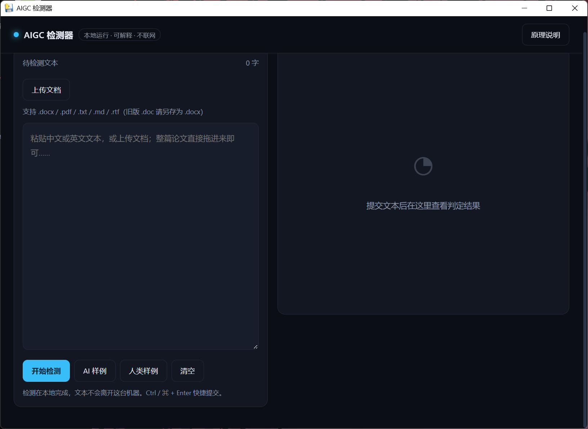

# AIGC Detector

[](https://github.com/ggg2761367/aigc-detector/actions/workflows/tests.yml)
[](https://doi.org/10.5281/zenodo.23760176)

**A local, explainable AI-text detector that runs on your own CPU — no network, no API key, no upload.**

<!-- 截图放这里：存成 docs/screenshot.png 后，删掉下一行的注释符号即可

-->

Everything happens on your machine. You paste text, you get a score, a sentence-level heatmap, a
feature-contribution breakdown, and a scan for invisible-character channels. The whole pipeline is
readable source, and the 130 MB neural classifier is optional.

[English](#english) · [简体中文](#简体中文) · [Attribution & licenses](ATTRIBUTION.md)

> This is an independent implementation built from public research. It does not reverse-engineer,
> call, or redistribute anything from commercial detection services. See [ATTRIBUTION.md](ATTRIBUTION.md).

---

## English

### What it does

| Capability | Detail |
|:---|:---|
| Heuristic engine | Perplexity, burstiness, boilerplate density, punctuation templates, sentence repetition, TTR, length uniformity. Zero third-party dependencies — works on a bare Python install. |
| Neural classifier (optional) | DistilmBERT fine-tuned for binary AI/human classification → ONNX int8, ~130 MB, 4–6 ms per 500 characters on CPU. Falls back silently if the weights are absent. |
| Sentence-level heatmap | Every sentence gets a score; the UI highlights which parts look machine-written. |
| Explainability | Per-feature `w·z` contributions are returned to the frontend and drawn as bars. Most commercial products do not show this. |
| Invisible-character scan | Unicode Tag characters, long variation-selector runs, bidi controls, zero-width characters, private-use glyphs, cross-script homoglyphs. Payloads are decoded and displayed as text. |
| Document upload | `.docx` (stdlib zip+XML), `.pdf` (text layer via pypdf), `.txt`/`.md`/`.csv`/`.rtf`. Scanned PDFs are reported as "no text layer". |
| Long documents | 400k characters per request (~200 pages). Sentence comparison degrades from exact O(n²) to windowed sampling above 600 sentences; MATTR switches to equidistant sampling. |

### What it is **not**

- **Not** a verdict. It outputs a probability, and probabilities are wrong sometimes.
- **Not** a plagiarism checker. It does not search any corpus.
- **Not** robust against rewriting / "humanizing" tools. Synonym substitution and sentence-length
  jitter both lower the score — see the OOD numbers below.
- **Not** a statistical-watermark verifier. SynthID-style watermarks need the key; C2PA lives in file
  metadata that is lost the moment text is copy-pasted.

### Quick start

Pick one. All three end at <http://127.0.0.1:8765/>.

#### Option A — Windows, no Python knowledge needed

1. Download `AIGC-Detector-win64.zip` from [Releases](../../releases).
2. Unzip anywhere (avoid `C:\Program Files` — it needs write access next to the exe).
3. Double-click `AIGC-Detector.exe`. A native window opens; there is no console window.

The packaged build already contains the ONNX weights, so nothing else is needed.

#### Option B — Run from source (any OS)

```bash
git clone https://github.com/ggg2761367/aigc-detector.git
cd aigc-detector

# Windows: double-click start.bat, or:
python launcher.py          # opens the browser for you, picks a free port

# macOS / Linux:
./start.sh
```

That is the whole install. **The heuristic engine needs nothing installed** — `python app.py` runs on a
bare Python 3.10+ with only the standard library.

To turn on the neural classifier and PDF support:

```bash
python -m venv .venv
.venv\Scripts\activate          # Windows;  source .venv/bin/activate on macOS/Linux
pip install -r requirements.txt
python scripts/download_model.py      # 85 MB zip from GitHub Releases
python launcher.py
```

The download script needs nothing beyond the standard library. It also takes `--src <dir>` for offline
installs, `--url <zip>` for a self-hosted mirror, `--hf-repo` for HuggingFace, and `--check` to verify.

#### Option C — Docker

```bash
docker build -t aigc-detector .
docker run --rm -p 8765:8765 aigc-detector

# with the neural weights mounted in:
docker run --rm -p 8765:8765 -v "$PWD/models:/app/models:ro" aigc-detector
```

### Get the model weights

Weights are 133 MB raw / 85 MB zipped and are **not** in the repo. One command does it — the default
path is the GitHub Release, which needs no extra account:

```bash
python scripts/download_model.py
```

| Source | Command |
|:---|:---|
| GitHub Release (default) | `python scripts/download_model.py` |
| Pin a version | `--tag v1.0.0` |
| Any zip URL (CDN, mirror) | `--url https://.../aigc-detector-onnx-v1.zip` |
| HuggingFace | `--hf-repo user/aigc-detector-onnx` |
| Offline directory | `--src path/to/extracted/onnx` |
| Verify what you have | `--check` |

The Release asset is `aigc-detector-onnx-v1.zip`. Repo, tag and asset names are three constants at the
top of `scripts/download_model.py`, so a mirror or a new version needs a one-line change.

Downloaded files land in `models/distilmbert-aigc-onnx/`, which is gitignored. Without weights the app
still works — it just runs the heuristic engine only, and the UI says so.

### Using it

**Web UI** — paste text or drag a document in, press `开始检测`. `Ctrl/⌘ + Enter` submits.

**HTTP API** (the server is a plain `http.server`, no framework):

```bash
curl -s -X POST http://127.0.0.1:8765/api/analyze \
     -H "Content-Type: application/json" \
     -d '{"text":"综上所述，本研究具有重要的理论意义与实践价值。"}'
```

```bash
# document extraction only
curl -s -X POST "http://127.0.0.1:8765/api/extract?name=paper.docx" \
     -H "Content-Type: application/octet-stream" --data-binary @paper.docx

# health + current calibration parameters
curl -s http://127.0.0.1:8765/api/health
```

**Self-tests** (41 tests; 3 model tests auto-skip when weights are absent):

```bash
python -m unittest discover -s tests -v
python detector.py      # heuristic engine self-check
python watermark.py     # invisible-character self-check
```

### Benchmark

Held-out sets, cross-domain, including OOD rewrites:

| Subset | AUROC | TPR@1%FPR |
|:---|---:|---:|
| All | 0.959 | 0.365 |
| HC3 (in-domain zh/en) | 0.999 | 0.981 |
| PR-HPPT (Chinese academic) | 0.995 | 0.768 |
| MAGE (English cross-domain) | 0.950 | 0.318 |
| OOD GPT-4 rewrite | 0.860 | 0.231 |

Adding RAID improved cross-generator robustness (OOD AUROC 0.748 → 0.860) while **lowering** MAGE's
1% FPR tail (0.520 → 0.318). Global ranking got better; the extreme low-FPR English tail got worse.
That trade-off is reported as measured, not smoothed over.

### Calibration

The one knob worth tuning. In `detector.py`:

```python
CALIBRATION = {
    "temperature": 0.85,          # <1 pushes toward the extremes (more false positives)
    "min_shrink": 0.25,           # floor for very short inputs
    "full_confidence_chars": 200, # above this length, trust the score fully
    "tier_mid": 0.50,             # sentence-level "suspicious" threshold
    "tier_high": 0.75,            # sentence-level "highly likely" threshold
}
```

Restart the server to apply; `/api/health` echoes the active values.

### Train your own

```bash
pip install -r requirements-train.txt
python training/prepare_data.py      # HC3 / PR-HPPT / MAGE / RAID -> JSONL
python training/train_classifier.py  # DistilmBERT fine-tune, 135M params, 2 epochs, bf16
python training/evaluate.py          # AUROC, TPR@1%FPR, per-domain report
python training/calibrate.py         # per-language isotonic table
python training/export_onnx.py       # ONNX + int8 quantization
```

8 GB of VRAM is enough. Datasets are downloaded from their original publishers — nothing is
redistributed here, and their licenses are listed in [ATTRIBUTION.md](ATTRIBUTION.md).

### Repository layout

```
app.py               http.server entry: /api/analyze, /api/extract, /api/health
detector.py          heuristic features + scoring + calibration (zero deps)
watermark.py         invisible-character scan + payload decoding
document.py          docx / pdf / txt / md / rtf extraction
model_engine.py      ONNX int8 inference (optional, lazy-loaded)
desktop.py           pywebview native window (packaging entry point)
launcher.py          console launcher: free port + auto-open browser
static/              index.html, app.js, style.css — no CDN, no framework
tests/               41 unittest cases
training/            data prep, fine-tune, evaluate, calibrate, export
scripts/             download_model.py
```

### Citation

If this software contributes to your research, please cite it. GitHub renders a
**Cite this repository** button from [`CITATION.cff`](CITATION.cff); or use this BibTeX:

```bibtex
@software{aigc_detector_2026,
  author  = {ggg2761367},
  title   = {AIGC Detector: a local, explainable AI-generated-text detector},
  year    = {2026},
  doi     = {10.5281/zenodo.23760176},
  url     = {https://github.com/ggg2761367/aigc-detector},
  version = {v1.0.3}
}
```

Archived on Zenodo. `10.5281/zenodo.23760176` is the **concept DOI** — it always resolves to the
latest version, so cite it unless you need to pin v1.0.3 exactly
(`10.5281/zenodo.23760177`).

### License

Code: MIT. Weights: research / non-commercial if upstream datasets are NC. Details in
[ATTRIBUTION.md](ATTRIBUTION.md).

Issues and corrections welcome — especially if a citation or license note is wrong.

---

## 简体中文

**一个跑在你自己电脑上的 AI 文本检测器：可解释、不联网、不需要 API Key。**

文本不离开本机。粘贴进去，得到的是：总分、句级热力图、每个特征推了多少分，以及一段
「有没有被埋隐藏字符」的独立证据。整条链路都是可读源码，130MB 的神经分类器是可选件。

> 本项目是依据公开研究独立实现的，不逆向、不调用、不分发任何商业检测服务的东西。
> 边界与出处见 [ATTRIBUTION.md](ATTRIBUTION.md)。

### 它做什么

| 能力 | 说明 |
|:---|:---|
| 启发式引擎 | 困惑度、突发性、套话密度、标点模板、句间重复、词汇多样性、句长均匀度。零第三方依赖，裸 Python 就能跑。 |
| 神经分类器（可选） | DistilmBERT 二分类微调 → ONNX int8，约 130MB，CPU 单条 500 字 4–6ms。权重缺失时静默回退。 |
| 句级热力图 | 每句一个分数，界面上直接看出哪几句像机器写的。 |
| 可解释性 | 每个特征的 `w·z` 贡献回传前端画成条形图，商业产品基本不给这个。 |
| 隐藏字符扫描 | Unicode Tag 字符、变体选择符长序列、双向控制符、零宽字符、私用区字符、跨脚本同形字；载荷会被解码并当文本显示。 |
| 文档上传 | `.docx`（标准库 zip+XML）、`.pdf`（pypdf 提取文本层）、`.txt`/`.md`/`.csv`/`.rtf`；扫描件会明确报「无文本层」。 |
| 长文档 | 单次最多 40 万字（约 200 页）。超过 600 句时句间比较从精确两两比对降级为窗口抽样，MATTR 改等距取样。 |

### 它**不是**什么

- **不是判决**。输出的是概率，概率会错。
- **不是查重**。它不检索任何语料库。
- **对改写/降 AI 工具没有完整抵抗力**。同义替换、句长扰动都能压低分数，见下面的 OOD 数据。
- **不是统计水印验证器**。SynthID 一类需要密钥；C2PA 在文件元数据里，复制成纯文本就丢了。

### 快速开始

三种方式，终点都是 <http://127.0.0.1:8765/>。

#### 方式 A — Windows 免安装

1. 到 [Releases](../../releases) 下载 `AIGC-Detector-win64.zip`；
2. 解压到任意目录（**别放 `C:\Program Files`**，它需要在 exe 旁边写日志）；
3. 双击 `AIGC-Detector.exe`，弹出原生窗口，没有黑框。

打包版已内置 ONNX 权重，不需要再装任何东西。

#### 方式 B — 从源码跑（任意系统）

```bash
git clone https://github.com/ggg2761367/aigc-detector.git
cd aigc-detector

# Windows：双击 start.bat，或
python launcher.py          # 自动找空闲端口 + 打开浏览器

# macOS / Linux：
./start.sh
```

就这一步。**启发式引擎什么都不用装** —— `python app.py` 在裸 Python 3.10+ 上直接可用。

要启用神经分类器和 PDF 解析：

```bash
python -m venv .venv
.venv\Scripts\activate          # Windows；macOS/Linux 用 source .venv/bin/activate
pip install -r requirements.txt
python scripts/download_model.py      # 从 GitHub Release 拉 85MB 压缩包
python launcher.py
```

下载脚本本身只用标准库。另外支持 `--src <目录>` 离线安装、`--url <zip>` 自建直链、
`--hf-repo` 走 HuggingFace、`--check` 核对文件。

#### 方式 C — Docker

```bash
docker build -t aigc-detector .
docker run --rm -p 8765:8765 aigc-detector

# 挂载神经权重：
docker run --rm -p 8765:8765 -v "$PWD/models:/app/models:ro" aigc-detector
```

### 下载模型权重

133MB（压缩后 85MB），**不在仓库里**。一条命令搞定，默认走 GitHub Release，不用另注册账号：

```bash
python scripts/download_model.py
```

| 来源 | 命令 |
|:---|:---|
| GitHub Release（默认） | `python scripts/download_model.py` |
| 指定版本 | `--tag v1.0.0` |
| 任意 zip 直链（CDN / 镜像） | `--url https://.../aigc-detector-onnx-v1.zip` |
| HuggingFace | `--hf-repo user/aigc-detector-onnx` |
| 离线目录 | `--src 解压后的目录` |
| 检查本地是否齐备 | `--check` |

Release 资产名是 `aigc-detector-onnx-v1.zip`。仓库名、tag、资产名是脚本顶部三个常量，
换镜像或换版本各改一行。

文件解到 `models/distilmbert-aigc-onnx/`，该目录已被 gitignore。没有权重也能用 ——
只走启发式，界面会标明当前模式。

### 怎么用

**网页**：粘贴或把文档拖进输入框，点「开始检测」，`Ctrl/⌘ + Enter` 直接提交。

**HTTP 接口**（就是标准库 `http.server`，没有框架）：

```bash
curl -s -X POST http://127.0.0.1:8765/api/analyze \
     -H "Content-Type: application/json" \
     -d '{"text":"综上所述，本研究具有重要的理论意义与实践价值。"}'
```

```bash
# 只提取文档文本
curl -s -X POST "http://127.0.0.1:8765/api/extract?name=论文.docx" \
     -H "Content-Type: application/octet-stream" --data-binary @论文.docx

# 健康检查 + 当前校准参数
curl -s http://127.0.0.1:8765/api/health
```

**自测**（41 项；缺权重时 3 项模型测试自动跳过）：

```bash
python -m unittest discover -s tests -v
python detector.py      # 启发式引擎自测
python watermark.py     # 隐藏字符自测
```

### 指标

留出集，跨领域，含 OOD 改写：

| 子集 | AUROC | TPR@1%FPR |
|:---|---:|---:|
| 全部 | 0.959 | 0.365 |
| HC3（同源中英） | 0.999 | 0.981 |
| PR-HPPT（中文学术） | 0.995 | 0.768 |
| MAGE（英文跨领域） | 0.950 | 0.318 |
| OOD GPT-4 改写 | 0.860 | 0.231 |

并入 RAID 后跨生成器鲁棒性提升（OOD AUROC 0.748 → 0.860），但 MAGE 的 1% FPR 尾部反而
从 0.520 降到 0.318 —— 全局排序更好，极端低误报下的英文尾部更难。这是真实权衡，不做粉饰。

### 校准

唯一真正该由你决定的地方，在 `detector.py` 末尾：

```python
CALIBRATION = {
    "temperature": 0.85,          # <1 往两端推，假阳性变多
    "min_shrink": 0.25,           # 极短文本的分数下限
    "full_confidence_chars": 200, # 超过这个字数就完全采信
    "tier_mid": 0.50,             # 句级「可疑」阈值
    "tier_high": 0.75,            # 句级「高度疑似」阈值
}
```

改完重启生效，`/api/health` 会回显当前值。

### 自己训练

```bash
pip install -r requirements-train.txt
python training/prepare_data.py      # HC3 / PR-HPPT / MAGE / RAID -> JSONL
python training/train_classifier.py  # DistilmBERT 微调，135M 参数，2 epoch，bf16
python training/evaluate.py          # AUROC / TPR@1%FPR / 分领域报告
python training/calibrate.py         # 按语言分表的 isotonic 校准
python training/export_onnx.py       # ONNX + int8 量化
```

8GB 显存够用。数据集从原始发布方下载，本仓库不分发任何数据；许可证见
[ATTRIBUTION.md](ATTRIBUTION.md)。

### 目录

```
app.py               http.server 入口：/api/analyze、/api/extract、/api/health
detector.py          启发式特征 + 打分 + 校准（零依赖）
watermark.py         不可见字符扫描 + 载荷解码
document.py          docx / pdf / txt / md / rtf 提取
model_engine.py      ONNX int8 推理（可选，懒加载）
desktop.py           pywebview 原生窗口（打包入口）
launcher.py          控制台启动器：空闲端口 + 自动开浏览器
static/              index.html、app.js、style.css —— 无 CDN、无框架
tests/               41 项 unittest
training/            数据准备 / 微调 / 评测 / 校准 / 导出
scripts/             download_model.py
```

### 引用

如果本项目对你的研究有帮助，欢迎引用。GitHub 会根据 [`CITATION.cff`](CITATION.cff)
在仓库首页渲染 **Cite this repository** 按钮，点开即可复制；也可用这条 BibTeX：

```bibtex
@software{aigc_detector_2026,
  author  = {ggg2761367},
  title   = {AIGC Detector: a local, explainable AI-generated-text detector},
  year    = {2026},
  doi     = {10.5281/zenodo.23760176},
  url     = {https://github.com/ggg2761367/aigc-detector},
  version = {v1.0.3}
}
```

已存档于 Zenodo。`10.5281/zenodo.23760176` 是**概念 DOI**，永远指向最新版本，一般引这个；
需要精确锁定 v1.0.3 时用 `10.5281/zenodo.23760177`。

### 许可

代码 MIT。权重在上游数据集带 NC 条款时仅限研究与非商业用途。细节见
[ATTRIBUTION.md](ATTRIBUTION.md)。

引用标注有误、或发现遗漏的出处，欢迎开 issue。
